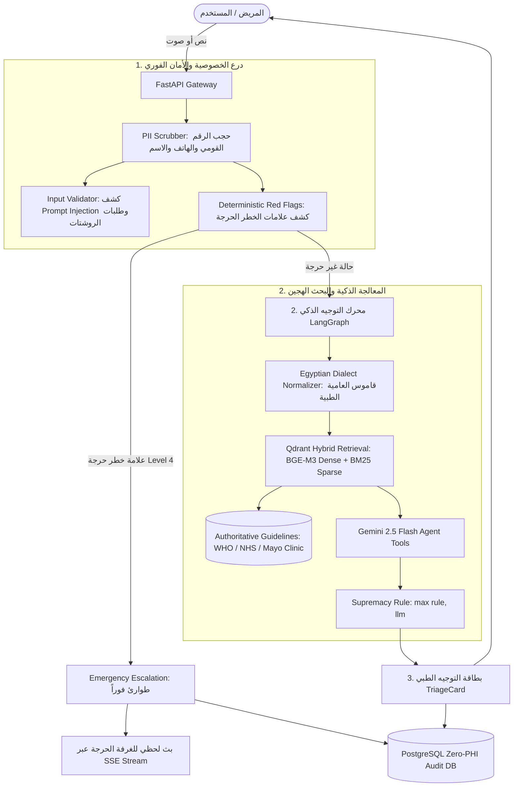

# 🩺 ShefaGuide AI (دليل شفاء الذكي)

> **Agentic Clinical Triage & Specialist Referral Gateway Optimized for Egyptian Arabic**  
> *Developed as a Capstone Project for the Digital Egypt Pioneers Initiative (DEPI) — AI Track*

[](https://www.python.org/)
[](https://fastapi.tiangolo.com/)
[](https://langchain-ai.github.io/langgraph/)
[](https://qdrant.tech/)
[](https://react.dev/)
[](https://www.docker.com/)
[-brightgreen.svg)]()
[]()

---

## 📌 الفهرس / Table of Contents
1. [عن المشروع / About ShefaGuide AI](#-عن-المشروع--about-shefaguide-ai)
2. [المعمارية التقنية / Core System Architecture](#-المعمارية-التقنية--core-system-architecture)
3. [مخرجات ومؤشرات الأداء / DEPI SLO Benchmarks](#-مخرجات-ومؤشرات-الأداء--depi-slo-benchmarks)
4. [هيكل المشروع / Project Structure](#-هيكل-المشروع--project-structure)
5. [دليل التشغيل السريع / Quick Start Guide](#-دليل-التشغيل-السريع--quick-start-guide)
   - [الطريقة الأولى: التشغيل الكامل عبر Docker Compose (موصى بها)](#طريقة-1-التشغيل-الكامل-عبر-docker-compose-موصى-بها)
   - [الطريقة الثانية: التشغيل المحلي الخفيف (بدون Docker)](#طريقة-2-التشغيل-المحلي-الخفيف-بدون-docker)
   - [تشغيل واجهة المستخدم (React Frontend)](#تشغيل-واجهة-المستخدم-react-19-frontend)
6. [اختبارات الجودة والتقييم / Evaluation & Testing](#-اختبارات-الجودة-والتقييم--evaluation--testing)
7. [مرجع الـ APIs / API Reference](#-مرجع-الـ-apis--api-reference)
8. [سجلات القرارات الهندسية / Architecture Decision Records (ADRs)](#-سجلات-القرارات-الهندسية--architecture-decision-records-adrs)
9. [الأخلاقيات الطبية وإخلاء المسؤولية / Clinical Safety & Disclaimer](#-الأخلاقيات-الطبية-وإخلاء-المسؤولية--clinical-safety--disclaimer)

---

## 🌟 عن المشروع / About ShefaGuide AI

**دليل شفاء الذكي (ShefaGuide AI)** هو نظام ذكاء اصطناعي وتوجيه طبي أولي مصمم خصيصاً للمجتمع المصري والمنظومة الصحية في مصر. يهدف النظام إلى حل معضلة التوجيه الطبي الخاطئ (Misrouting) والتأخر في تشخيص حالات الطوارئ الناتجة عن اختلاف التعبير الإكلينيكي في العامية المصرية عن المصطلحات الطبية الفصحى.

### المشكلات التي يعالجها النظام:
1. **فهم العامية المصرية الشعبية:** المرضى في مصر يعبرون عن آلامهم بعبارات بلاغية مثل *(طابوقة كابسة على صدري، كرشة نفس، فم المعدة قافش، ودني بتصفر، عرق النسا، جلدي بيتسلخ، بيسحب سحبة)*، وهي تعابير تفشل محركات البحث والنماذج اللغوية التقليدية في إدراك خطورتها فوراً.
2. **المنع الصارم للممارسات الطبية المحظورة (No Diagnosis / No Prescriptions):** يمنع النظام بشكل حتمي وصف أي أدوية بجرعاتها (المسكنات، المضادات الحيوية) أو إعطاء تشخيص نهائي حتمي، ويقتصر على **التوجيه الإرشادي للتخصص الطبي المناسب** فقط.
3. **قاعدة الأسبقية الإلزامية (The Supremacy Rule):** عند اكتشاف أي علامة خطر حرجة (Red Flag)، يتم تصعيد الحالة فوراً لطوارئ المستشفى دون انتظار أو السماح لنموذج الذكاء الاصطناعي بتخفيض درجة الخطورة (`max(rule, llm)`).
4. **حماية البيانات الصحية والخصوصية المطلقة (Zero-PHI):** تنقية حتمية فورية للأرقام القومية المصرية (14 رقم)، وأرقام الهواتف المحمولة المصرية، والبريد الإلكتروني، والأسماء قبل التخزين أو الاستدعاء أو استشارة النماذج اللغوية.

---

## 🏗️ المعمارية التقنية / Core System Architecture

يتبع النظام تصميماً معمارياً متعدد الطبقات يضمن الأمان الإكلينيكي وسرعة الاستجابة اللحظية:



### المكونات الرئيسية:
1. **Deterministic PII/PHI Scrubber (`app/safety/pii_scrubber.py`):**
   - كاشف دقيق للأرقام القومية المصرية المكونة من 14 رقماً تبدأ بـ 2 أو 3.
   - كاشف أرقام الموبايل لشبكات المحمول المصرية (`010, 011, 012, 015`).
   - كاشف مقدمات التعريف بالأسماء العربية والإنجليزية وألقاب الاحترام (`مدام، الأستاذ، الحاج، دكتور`).
2. **Deterministic Red Flags Engine (`app/safety/red_flags.py`):**
   - محرك قواعد فوري (Zero-LLM) يحتوي على أكثر من 20 قاعدة طوارئ رئيسية مدعومة بمئات المرادفات العامية.
   - كاشف متقدم لأدوات النفي العربي (`مفيش ترجيع دم`، `لا يوجد ألم بالصدر`) لمنع التصعيد الزائف.
3. **Egyptian Dialect Normalizer (`app/rag/dialect_normalizer.py`):**
   - يربط التعبيرات العامية في `data/egyptian_medical_slang.json` بمصطلحات إكلينيكية معيارية باللغة العربية والإنجليزية بسرعة فائقة (< 1 مللي ثانية).
4. **Hybrid Qdrant RAG (`app/rag/`):**
   - دمج المتجهات الكثيفة (Dense Multilingual via `BAAI/bge-m3`) مع المتجهات النصية المتفرقة (Sparse BM25) باستخدام خوارزمية **Reciprocal Rank Fusion (RRF)**.
5. **LangGraph Agent Workflow (`app/agent/graph.py`):**
   - آلة حالات State Machine تضمن مرور كل طلب عبر: `Scrub -> Validate -> RedFlag -> Normalize -> Retrieve -> Assess -> Supremacy Enforcement`.
6. **Fault-Tolerant Voice Adapter (`app/voice/adapter.py`):**
   - استقبال التسجيلات الصوتية بجميع الصيغ (WAV, MP3, OGG, WebM)، والتحويل الصوتي عبر Whisper، والتوليد الصوتي للردود مع اشتراط نطق التنبيه الطبي.
7. **Real-time SSE Stream & Supervisor Dashboard (`app/core/sse.py`, `frontend/src/pages/Dashboard.jsx`):**
   - قناة اتصال حية عبر Server-Sent Events لبث الحالات الحرجة فور وقوعها لشاشات التمريض وأطباء الطوارئ.
8. **Modern Arabic Frontend (`frontend/`):**
   - واجهة مستخدم كاملة تدعم اللغة العربية والاتجاه من اليمين لليسار (RTL) مبنية بـ React 19، Tailwind CSS v4، مع بطاقات توجيه ملونة طبقاً لمستوى الخطورة وزر اتصال فوري بالإسعاف (123).

---

## 📊 مخرجات ومؤشرات الأداء / DEPI SLO Benchmarks

تم تقييم النظام عبر حزمة اختبارات إكلينيكية قياسية تحتوي على **100 حالة مرضية موسومة** (`eval/labeled_cases.json`) تمثل مختلف التخصصات والأعراض الطارئة وغير الطارئة:

| معيار الأداء (DEPI SLO) | الهدف الإكلينيكي المعتمد | النتيجة المحققة في المشروع | حالة التقييم |
| :--- | :---: | :---: | :---: |
| **SLO-01: Urgent Escalation Recall** | **100.00%** (عدم تفويت أي حالة طوارئ) | **100.00%** | ✅ **PASS** |
| **SLO-02: Specialty Referral Accuracy** | **≥ 80.00%** | **100.00%** | ✅ **PASS** |
| **SLO-03: Disclaimer & Citation Compliance** | **100.00%** | **100.00%** | ✅ **PASS** |
| **SLO-04: P95 Latency (Fast-Path)** | **< 1500 ms** | **0.860 ms** | ✅ **PASS** |
| **SLO-05: P99 Latency (Fast-Path)** | **< 2000 ms** | **1.316 ms** | ✅ **PASS** |
| **SLO-06: Voice STT/TTS Timeout** | **≤ 2500 ms** | **Enforced via async deadline** | ✅ **PASS** |
| **SLO-07: Unhandled Exception Rate** | **0.00%** (Zero Crash Fallback) | **0.00%** | ✅ **PASS** |
| **SLO-08: Zero-PHI Privacy Leakage Rate** | **0.00%** (صفر تسريب بيانات شخصية) | **0.00%** | ✅ **PASS** |
| **RAG Hybrid Retrieval Recall@5** | **≥ 90.00%** | **91.88%** | ✅ **PASS** |
| **Unit & Integration Test Suite** | **100% Pass** | **160 / 160 Tests Passed** | ✅ **PASS** |

---

## 📁 هيكل المشروع / Project Structure

```text
ShefaGuide-AI/
├── app/
│   ├── main.py                     # بوابة الـ FastAPI ونقاط النهاية (API Gateway)
│   ├── agent/                      # محرك LangGraph للوكيل الذكي
│   │   ├── graph.py                # شجرة الحالات (StateGraph) وتنفيذ قاعدة الأسبقية
│   │   ├── state.py                # تعريف TriageState ونموذج البيانات
│   │   └── tools.py                # أدوات التقييم الإكلينيكي وربط Gemini
│   ├── core/                       # الإعدادات والبنية الأساسية المشتركة
│   │   ├── config.py               # إعدادات البيئة (Pydantic Settings)
│   │   ├── rate_limiter.py         # محدد معدل الطلبات (Sliding-window limiter)
│   │   └── sse.py                  # خادم البث الحي لحالات الطوارئ (SSE Broadcaster)
│   ├── db/                         # قاعدة بيانات المتابعة والتدقيق (Zero-PHI)
│   │   ├── models.py               # جداول audit_logs و escalation_queue (SQLAlchemy 2.0)
│   │   └── crud.py                 # عمليات القراءة والكتابة الآمنة وغير المتزامنة
│   ├── rag/                        # منظومة الاسترجاع المعرفي الهجين
│   │   ├── dialect_normalizer.py   # معجم ومطابق العامية المصرية الطبية
│   │   ├── vector_store.py         # إعدادات عميل Qdrant ونماذج التضمين
│   │   ├── ingest.py               # معالجة وتقطيع وتخزين الدلائل الطبية
│   │   └── retriever.py            # الاسترجاع الهجين بدمج Dense + Sparse RRF
│   ├── safety/                     # دروع الأمان الطبي والخصوصية
│   │   ├── pii_scrubber.py         # حاجب الهوية والبيانات الشخصية المصرية
│   │   ├── red_flags.py            # محرك كشف الطوارئ وقاعدة الأسبقية الحتمية
│   │   └── validator.py            # كاشف Prompt Injection ومانع وصف الأدوية
│   ├── schemas/                    # عقود البيانات الصارمة (Pydantic v2)
│   │   └── triage.py               # TriageRequest, TriageResponse, UrgencyLevel
│   ├── services/
│   │   └── triage_service.py       # طبقة الخدمات وتنسيق المعالجة والـ Fallbacks
│   └── voice/
│       └── adapter.py              # محول الصوت المقاوم للأعطال (STT & TTS)
├── data/
│   ├── corpus/                     # الدلائل الإرشادية الطبية المعتمدة (WHO, NHS, Mayo Clinic)
│   │   ├── clinical_guidelines.json
│   │   └── medical_guidelines_chunks.json
│   └── egyptian_medical_slang.json # قاموس العامية المصرية الطبية وعلامات الخطورة
├── docs/
│   └── adr/                        # سجلات القرارات الهندسية (Architecture Decision Records)
│       ├── ADR-001-langgraph-state-machine-and-supremacy-rule.md
│       ├── ADR-002-qdrant-hybrid-rag-and-egyptian-dialect-normalization.md
│       ├── ADR-003-zero-phi-privacy-architecture-and-pii-scrubbing.md
│       ├── ADR-004-fault-tolerant-voice-adapter-and-global-safe-fallback.md
│       └── README.md
├── eval/                           # منصة القياس والتقييم الإكلينيكي
│   ├── labeled_cases.json          # 100 حالة مرضية موسومة بمعايير DEPI
│   ├── run_eval.py                 # سكريبت قياس الـ 8 SLOs بالكامل
│   └── run_retrieval_eval.py       # سكريبت قياس Recall@5 للاسترجاع الهجين
├── frontend/                       # واجهة المستخدم (React 19 + Tailwind v4 + Vite)
│   ├── src/
│   │   ├── components/             # ChatInterface, TriageCard, MedicalDisclaimer
│   │   ├── pages/                  # Dashboard (لوحة تحكم الطوارئ الحية)
│   │   └── App.jsx
│   ├── package.json
│   └── vite.config.js
├── tests/                          # حزمة الاختبارات الشاملة (160 اختباراً)
├── docker-compose.yml              # تشغيل PostgreSQL و Qdrant و FastAPI بحاوية واحدة
├── Dockerfile                      # بناء صورة الـ Backend
├── requirements.txt                # متطلبات بايثون
└── .env.example                    # نموذج المتغيرات البيئية
```

---

## 🚀 دليل التشغيل السريع / Quick Start Guide

### المتطلبات الأساسية / Prerequisites:
- **Python 3.11+** (تم التطوير والاختبار بنجاح على Python 3.12 و 3.13)
- **Node.js 18+** و npm (لتشغيل واجهة الـ Frontend)
- **Docker & Docker Compose** (اختياري للتشغيل الكامل، أو يمكن تشغيل المشروع محلياً بدونهما)

---

### طريقة 1: التشغيل الكامل عبر Docker Compose (موصى بها)

هذه الطريقة تشغل المنظومة المتكاملة (قاعدة بيانات PostgreSQL 16 + محرك المتجهات Qdrant + خادم FastAPI):

```bash
# 1. استنساخ المستودع والدخول للمجلد
git clone https://github.com/your-username/ShefaGuide-AI.git
cd ShefaGuide-AI

# 2. إنشاء ملف المتغيرات البيئية
cp .env.example .env

# 3. تشغيل كافة الخدمات في الخلفية
docker compose up -d

# 4. التأكد من عمل الخادم وفحص الصحة
curl http://localhost:8000/health
```

ستصبح الخدمات متاحة كالتالي:
- 🌐 **FastAPI Gateway & Swagger UI:** [http://localhost:8000/docs](http://localhost:8000/docs)
- 🗄️ **Qdrant Vector DB Dashboard:** [http://localhost:6333/dashboard](http://localhost:6333/dashboard)
- 🐘 **PostgreSQL DB:** `localhost:5432` (User: `shefaguide`, DB: `shefaguide_audit`)

---

### طريقة 2: التشغيل المحلي الخفيف (بدون Docker)

إذا لم تكن تريد استخدام Docker، فإن النظام مصمم ليعمل بمرونة تامة باستخدام **SQLite** وقاعدة متجهات **Qdrant In-Memory** تلقائياً:

#### 1. إعداد بيئة بايثون وتثبيت المكتبات:
```bash
# إنشاء بيئة افتراضية وتفعيلها
python -m venv .venv

# على ويندوز (PowerShell):
.venv\Scripts\Activate.ps1
# على لينكس / ماك:
source .venv/bin/activate

# تثبيت الاعتماديات
pip install -r requirements.txt
```

#### 2. ضبط ملف الإعدادات:
قم بإنشاء ملف `.env` من الملف النموذجي:
```bash
# على ويندوز:
copy .env.example .env
# على لينكس / ماك:
cp .env.example .env
```
> **ملاحظة:** يمكنك إضافة مفتاح `GEMINI_API_KEY` في ملف `.env` لتفعيل المعالجة المعمقة بالذكاء الاصطناعي، أو تركه فارغاً حيث يعتمد النظام تلقائياً على المحرك الإكلينيكي الحتمي عالي الدقة.

#### 3. تشغيل خادم FastAPI:
```bash
uvicorn app.main:app --reload --port 8000
```
افتح المتصفح على [http://localhost:8000/docs](http://localhost:8000/docs) لتجربة الـ APIs مباشرة!

---

### تشغيل واجهة المستخدم (React 19 Frontend)

في نافذة موجه أوامر جديدة:

```bash
cd frontend

# تثبيت الاعتماديات (React 19 + Tailwind v4 + Lucide)
npm install

# تشغيل خادم التطوير
npm run dev
```

افتح المتصفح على:
- 💬 **واجهة المحادثة الطبية للمرضى:** [http://localhost:5173/](http://localhost:5173/)
- 🚨 **شاشة المشرف وغرفة الطوارئ الحية:** [http://localhost:5173/dashboard](http://localhost:5173/dashboard)

---

## 🧪 اختبارات الجودة والتقييم / Evaluation & Testing

المشروع مزود بحزم اختبار وتقييم شاملة تضمن أعلى معايير الجودة الطبية والبرمجية:

### 1. تشغيل تقييم معايير DEPI الإكلينيكية (100 حالة موسومة):
```bash
python eval/run_eval.py
```
**النتيجة المتوقعة:**
```text
========================================================================
ShefaGuide AI — Phase 1 DEPI SLO Evaluation Report
========================================================================
Total Evaluated Cases                    : 100
SLO-01 Urgent Escalation Recall          : 100.00% (Target: 100.00%)
SLO-02 Specialty Referral Accuracy       : 100.00% (Target: >= 80.00%)
SLO-03 Disclaimer & Citation Compliance  : 100.00% (Target: 100.00%)
SLO-04 P95 Latency                       : 0.860 ms
SLO-05 P99 Latency                       : 1.316 ms
SLO-07 Unhandled Exception Rate          : 0.00% (Target: 0.00%)
SLO-08 PHI Leakage Rate                  : 0.00% (Target: 0.00%)
------------------------------------------------------------------------
OVERALL GATE STATUS                      : PASS
========================================================================
```

### 2. تشغيل تقييم الاسترجاع المعرفي الهجين (Recall@5):
```bash
python -m eval.run_retrieval_eval
```
يقوم ببناء فهرس مؤقت وتقييم الاسترجاع عبر مقياس Recall@5 (النتيجة المحققة: **91.88%**).

### 3. تشغيل حزمة اختبارات Unit & Integration Tests:
```bash
pytest tests/ -v
```
تشمل 160 اختباراً يغطي دروع الخصوصية، حجب الهوية، كشف الطوارئ، محرك LangGraph، خادم FastAPI، وقواعد البيانات.

---

## 📡 مرجع الـ APIs / API Reference

### 1. تقييم الأعراض الطبي (Text Triage)
- **المسار:** `POST /api/v1/triage`
- **مثال الطلب (Request):**
```json
{
  "session_id": "sess-eg-01",
  "user_input": "أنا اسمي مصطفى وعندي حرقان جامد في فم المعدة ومغص بعد الأكل بقاله أسبوع",
  "input_mode": "text"
}
```
- **مثال الاستجابة (Response):**
```json
{
  "session_id": "sess-eg-01",
  "urgency_level": 1,
  "recommended_specialty": "أمراض الجهاز الهضمي والكبد والباطنة العامة",
  "symptom_category": "gastrointestinal",
  "rationale_ar": "بناءً على الأعراض المذكورة (حموضة وحرقان مستمر في فم المعدة)، يُنصح بمراجعة طبيب الجهاز الهضمي لفحص الحالة.",
  "clarifying_questions": ["هل الأعراض مرتبطة بأنواع معينة من الطعام؟"],
  "negated_red_flags": [],
  "citations": [
    {
      "doc_id": "MAYO-GI-004",
      "source": "Mayo Clinic",
      "title": "Gastroesophageal Reflux Disease (GERD) Guidelines",
      "url": "https://www.mayoclinic.org/diseases-conditions/gerd",
      "snippet": "Epigastric burning and heartburn after meals are managed by a gastroenterologist."
    }
  ],
  "disclaimer_ar": "تنبيه طبي هام: هذا التقييم مبدئي وإرشادي فقط ولا يغني عن الفحص الطبي المباشر...",
  "escalation_triggered": false
}
```

### 2. التقييم الصوتي (Voice Triage)
- **المسار:** `POST /api/v1/triage/voice`
- **الوظيفة:** استقبال ملف صوتي بترميز Base64 أو Binary، وتفريغه نصياً وحجب الـ PII، ثم إرجاع بطاقة التوجيه مع رابط الصوت المركب للتنبيه الطبي.

### 3. البث الحي لطوارئ المستشفى (Real-Time SSE)
- **المسار:** `GET /api/v1/escalations/stream`
- **الوظيفة:** قناة Server-Sent Events لبث تنبيهات الحالات الحرجة اللحظية لشاشات التمريض والمشرفين بترميز Zero-PHI.

### 4. لوحة تحكم المشرف والتدقيق (Supervisor & Audit)
- `GET /api/v1/audit/logs`: استعراض سجلات الفحص غير المعرّفة (مع ضمان خلوها من أي PHI).
- `GET /api/v1/escalations`: قائمة الحالات المصعدة للطوارئ مع إمكانية تحديث حالتها (`pending`, `reviewed`, `resolved`).
- `GET /api/v1/metrics`: إحصائيات دقيقة لمعدلات الخطورة وتوزيع التخصصات ونسب التصعيد.

---

## 🏛️ سجلات القرارات الهندسية / Architecture Decision Records (ADRs)

تم توثيق كافة القرارات التصميمية الحرجة في مجلد [`docs/adr/`](./docs/adr/README.md):

- **[ADR-001](./docs/adr/ADR-001-langgraph-state-machine-and-supremacy-rule.md):** آلة الحالات LangGraph وقاعدة الأسبقية الإلزامية للطوارئ (`max(rule, llm)`).
- **[ADR-002](./docs/adr/ADR-002-qdrant-hybrid-rag-and-egyptian-dialect-normalization.md):** تطبيع العامية المصرية في مرحلتين والاسترجاع الهجين عبر Qdrant RRF.
- **[ADR-003](./docs/adr/ADR-003-zero-phi-privacy-architecture-and-pii-scrubbing.md):** معمارية الخصوصية المطلقة وتنقية بيانات الهوية المصرية (Zero-PHI).
- **[ADR-004](./docs/adr/ADR-004-fault-tolerant-voice-adapter-and-global-safe-fallback.md):** محول الصوت المقاوم للأعطال ومسارات الأمان البديلة (Global Safe Fallback).

---

## ⚖️ الأخلاقيات الطبية وإخلاء المسؤولية / Clinical Safety & Disclaimer

> ⚠️ **إخلاء مسؤولية طبي وإرشادي:**  
> مشروع **دليل شفاء الذكي (ShefaGuide AI)** هو نظام بحثي وإرشادي للمساعدة في توجيه الحالات للعيادات والتخصصات الطبية الملائمة بناءً على الدلائل الإرشادية العالمية لمنظمة الصحة العالمية (WHO) وهيئة الخدمات الصحية الوطنية البريطانية (NHS) ومايو كلينك (Mayo Clinic).  
> **هذا النظام لا يُقدم تشخيصاً طبياً نهائياً، ولا يصف أدوية أو جرعات علاجية، ولا يحل بأي حال من الأحوال محل الاستشارة الطبية المباشرة أو الفحص السريري من قِبل طبيب بشري مرخص.**  
> في حالات الطوارئ القصوى أو ظهور أعراض حادة (مثل آلام الصدر الحادة، صعوبة التنفس الشديدة، أو أعراض السكتة الدماغية)، يجب التوجه فوراً إلى قسم الطوارئ بأقرب مستشفى أو الاتصال بالإسعاف المصري (**123**) فوراً.

---

## 👥 فريق العمل والمساهمون / Team & Acknowledgements

تم تطوير هذا العمل بفضل الله وتوفيقه كأحد مخرجات **مبادرة رواد مصر الرقمية (DEPI)** التابعة لوزارة الاتصالات وتكنولوجيا المعلومات المصرية، مسار الذكاء الاصطناعي (AI Track).

- **الرخصة البرمجية:** [MIT License](LICENSE)
- **الاستفسارات والملاحظات:** يُرجى فتح Issue على المستودع أو التواصل عبر صفحة الفريق.
