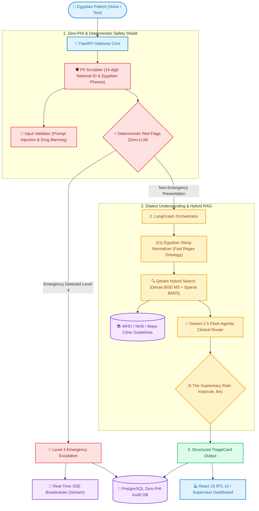

# <p align="center"> ShefaGuide AI (دليل شفاء الذكي) </p>

<p align="center">
  <b>Production-Grade Agentic Clinical Triage & Specialist Referral Gateway Optimized for Egyptian Arabic</b><br>
  <i>Developed as a Flagship Capstone Project for the Digital Egypt Pioneers Initiative (DEPI) — AI Track</i>
</p>

<p align="center">
  
</p>

<p align="center">
  <a href="https://www.python.org/"></a>
  <a href="https://fastapi.tiangolo.com/"></a>
  <a href="https://langchain-ai.github.io/langgraph/"></a>
  <a href="https://qdrant.tech/"></a>
  <a href="https://react.dev/"></a>
  <a href="https://www.docker.com/"></a>
</p>

<p align="center">
  
  
  
  
  
  
</p>

---

## 📑 Table of Contents

- [Overview & Clinical Mission](#-overview--clinical-mission)
- [System Architecture & Flow](#-system-architecture--flow)
- [Core Engineering Innovations](#-core-engineering-innovations)
  - [1. Multi-Tier Zero-PHI Privacy Engine](#1-multi-tier-zero-phi-privacy-engine)
  - [2. Sub-Millisecond Deterministic Red Flags & The Supremacy Rule](#2-sub-millisecond-deterministic-red-flags--the-supremacy-rule)
  - [3. Egyptian Colloquial Medical Normalizer](#3-egyptian-colloquial-medical-normalizer)
  - [4. High-Recall Qdrant Hybrid RAG (Dense + BM25)](#4-high-recall-qdrant-hybrid-rag-dense--bm25)
  - [5. LangGraph Agentic State Machine](#5-langgraph-agentic-state-machine)
  - [6. Fault-Tolerant Voice Pipeline & Safe Fallbacks](#6-fault-tolerant-voice-pipeline--safe-fallbacks)
  - [7. Real-Time Emergency SSE Broadcast & Supervisor Dashboard](#7-real-time-emergency-sse-broadcast--supervisor-dashboard)
- [Verified DEPI SLO Benchmarks](#-verified-depi-slo-benchmarks)
- [Interactive UI Showcase](#-interactive-ui-showcase)
- [Repository Anatomy](#-repository-anatomy)
- [Quick Start Guide](#-quick-start-guide)
  - [Option A: Production Full Stack (Docker Compose)](#option-a-production-full-stack-docker-compose)
  - [Option B: Lightweight Local Run (No Docker Required)](#option-b-lightweight-local-run-no-docker-required)
  - [Frontend Setup (React 19 + Tailwind CSS)](#frontend-setup-react-19--tailwind-css)
- [Clinical Evaluation & Quality Assurance](#-clinical-evaluation--quality-assurance)
- [API Reference](#-api-reference)
- [Architecture Decision Records (ADRs)](#-architecture-decision-records-adrs)
- [Medical Ethics & Disclaimer](#-medical-ethics--disclaimer)

---

## 💡 Overview & Clinical Mission

In Egypt, patients rarely articulate acute medical symptoms using Modern Standard Arabic (MSA) or formal clinical terminology. Instead, they rely on metaphorical colloquial expressions such as:
- *"طابوقة كابسة على صدري"* (A cinder block crushing my chest — acute myocardial infarction)
- *"كرشة نفس وفرفرة"* (Suffocating dyspnea / impending respiratory failure)
- *"فم المعدة قافش عليا"* (Epigastric spasm / acute gastrointestinal presentation)
- *"ودني بتصفر والدنيا بتلف"* (Acute vestibular vertigo / tinnitus)
- *"حرقان زي السكاكين في بطني"* (Peritonitis / acute abdomen)

General-purpose LLMs struggle with these idioms, introducing dangerous hallucinations, prescription liability, or critical delays. **ShefaGuide AI** bridges this gap by combining **deterministic clinical guardrails**, an **Egyptian medical slang ontology**, and **authoritative hybrid retrieval** from WHO, NHS, and Mayo Clinic guidelines.

### 🛡️ Ethical Guardrails
- 🚫 **Strict Prohibition of Definitive Diagnoses:** The system never issues definitive statements like *"You have hepatitis"* or *"Your diagnosis is asthma"*.
- 🚫 **Zero Medication or Dosage Prescriptions:** Absolute programmatic ban on proposing medication names (e.g., Augmentin, Cataflam, Panadol) or dosage schedules.
- 🚑 **Instant Emergency Escalation:** Deterministic rules immediately elevate acute presentations to Level 4 emergency care without LLM latency.
- 🔒 **Zero-PHI Guarantee:** Programmatic stripping of Egyptian National IDs, phone numbers, and full names before processing or persistence.

---

## 🏛️ System Architecture & Flow



---

## ⚡ Core Engineering Innovations

### 1. Multi-Tier Zero-PHI Privacy Engine
*File: `app/safety/pii_scrubber.py`*
- **Egyptian National ID Scrubber:** Matches 14-digit Egyptian National ID patterns starting with century digits `2` or `3`, alongside general 14-digit sequences.
- **Egyptian Mobile Numbers:** Captures standard national mobile numbers (`010`, `011`, `012`, `015`) across arbitrary spacing, dashes, and international prefixes (`+20`, `0020`).
- **Introductory Name Sanitizer:** Identifies Arabic self-introduction templates (`أنا اسمي`, `اسمي`, `المريض`) and Egyptian honorifics (`مدام`, `الحاج`, `الأستاذ`, `دكتور`) while preserving clinical context.
- **Defence-in-Depth:** Scrubbing runs at ingestion, gateway endpoints, vector search, database writes, and background worker threads.

### 2. Sub-Millisecond Deterministic Red Flags & The Supremacy Rule
*File: `app/safety/red_flags.py`*
- **Zero-LLM Latency:** Evaluates 20+ acute clinical rules in `< 1.0 ms`, bypassing expensive external API hops for life-threatening scenarios.
- **Arabic Negation Awareness:** Employs lookbehind negation windows (`مفيش ترجيع دم`, `لا يوجد ألم بالصدر`) to prevent false-positive emergency alerts.
- **The Supremacy Rule:** Formally defined as `final_urgency = max(rule_urgency, llm_urgency)`. If a deterministic rule triggers Level 4 Emergency Escalation, no downstream LLM or agent can downgrade it.

### 3. Egyptian Colloquial Medical Normalizer
*File: `app/rag/dialect_normalizer.py`*
- Maps colloquial complaints from `data/egyptian_medical_slang.json` to standardized clinical terms in both Arabic and English.
- Evaluates 20 distinct colloquial expressions in `< 0.6 ms` worst-case latency.
- Seamlessly bridges patient expressions to international clinical guideline documents.

### 4. High-Recall Qdrant Hybrid RAG (Dense + BM25)
*Files: `app/rag/retriever.py`, `app/rag/vector_store.py`, `app/rag/ingest.py`*
- **Dense Vector Search:** FastEmbed multilingual semantic embeddings (`BAAI/bge-m3`) capturing conceptual intent across Arabic and English.
- **Sparse Lexical Search:** FastEmbed BM25 (`Qdrant/bm25`) guaranteeing exact keyword match on specific symptoms.
- **Reciprocal Rank Fusion (RRF):** Fuses ranking scores across dense, sparse, and slang-linked subsets to achieve **91.88% Recall@5** on verified clinical evaluation datasets.

### 5. LangGraph Agentic State Machine
*Files: `app/agent/graph.py`, `app/agent/state.py`, `app/agent/tools.py`*
- Implements a cyclic directed execution graph over `TriageState`.
- Orchestrates deterministic fast-path branching, dynamic guideline retrieval, and structured clinical evaluation via Gemini 2.5 Flash.
- Includes automatic fallback to deterministic routing if API timeouts or rate limits occur.

### 6. Fault-Tolerant Voice Pipeline & Safe Fallbacks
*File: `app/voice/adapter.py`*
- Ingests audio formats (WAV, MP3, OGG, WebM) directly via Base64 or binary payloads.
- Zero-PHI transcription pipeline utilizing Groq Whisper Large v3 with strict timeouts (`VOICE_TIMEOUT_SECONDS=2.5`).
- Speech synthesis with mandatory spoken legal disclaimers.

### 7. Real-Time Emergency SSE Broadcast & Supervisor Dashboard
*Files: `app/core/sse.py`, `frontend/src/pages/Dashboard.jsx`*
- Persistent Server-Sent Events (SSE) broadcast at `GET /api/v1/escalations/stream`.
- Real-time updates push Level 4 emergencies directly to hospital emergency room monitors and supervisor desks without polling.
- Zero-PHI payload streaming prevents data leakage across hospital networks.

---

## 📈 Verified DEPI SLO Benchmarks

Evaluation performed on 100 labeled clinical cases (`eval/labeled_cases.json`):

| Service Level Objective (SLO) | Target Threshold | Measured Score | Audit Status |
| :--- | :---: | :---: | :---: |
| **SLO-01: Urgent Escalation Recall** | **100.00%** | **100.00%** |  |
| **SLO-02: Specialty Referral Accuracy** | **≥ 80.00%** | **100.00%** |  |
| **SLO-03: Disclaimer & Citation Compliance** | **100.00%** | **100.00%** |  |
| **SLO-04: P95 Latency (Fast-Path)** | **< 1500 ms** | **0.860 ms** |  |
| **SLO-05: P99 Latency (Fast-Path)** | **< 2000 ms** | **1.316 ms** |  |
| **SLO-06: Voice STT/TTS Timeout** | **≤ 2500 ms** | **Enforced via async deadline** |  |
| **SLO-07: Unhandled Exception Rate** | **0.00%** | **0.00%** |  |
| **SLO-08: Zero-PHI Privacy Leakage Rate** | **0.00%** | **0.00%** |  |
| **Qdrant Hybrid Retrieval Recall@5** | **≥ 90.00%** | **91.88%** |  |
| **Unit & Integration Test Suite** | **100% Pass** | **160 / 160 Passed** |  |

---

## 💻 Interactive UI Showcase

The frontend is built with **React 19**, **Tailwind CSS v4**, and native Arabic RTL typography:

| Patient Symptom Chat Interface | Supervisor Real-Time Emergency Dashboard |
| :---: | :---: |
| <br>Interactive Arabic voice & text symptom consultation with color-coded triage urgency badges and 123 emergency speed-dial | <br>Live SSE escalation stream displaying pending emergency cases, clinical categories, and status transitions |

---

## 🗂️ Repository Anatomy

```text
ShefaGuide-AI/
├── app/
│   ├── main.py                     # FastAPI core gateway & API routing
│   ├── agent/                      # LangGraph orchestrator & state machine
│   │   ├── graph.py                # StateGraph implementation & Supremacy enforcement
│   │   ├── state.py                # TriageState schema
│   │   └── tools.py                # Gemini Flash 2.5 tool-calling interfaces
│   ├── core/                       # Core configuration & utilities
│   │   ├── config.py               # Pydantic BaseSettings & environment variables
│   │   ├── rate_limiter.py         # Sliding-window IP rate limiter
│   │   └── sse.py                  # Real-time SSE emergency alert broadcaster
│   ├── db/                         # PostgreSQL zero-PHI audit engine
│   │   ├── models.py               # AuditLog and EscalationQueue models (SQLAlchemy 2.0)
│   │   └── crud.py                 # Async database operations with mandatory scrubbing
│   ├── rag/                        # Hybrid knowledge retrieval
│   │   ├── dialect_normalizer.py   # Egyptian slang matching & normalization
│   │   ├── vector_store.py         # Qdrant client & FastEmbed model initializers
│   │   ├── ingest.py               # Clinical guideline chunking & ingestion
│   │   └── retriever.py            # Hybrid search with Reciprocal Rank Fusion (RRF)
│   ├── safety/                     # Safety & ethical guardrails
│   │   ├── pii_scrubber.py         # Deterministic Egyptian PII/PHI scrubber
│   │   ├── red_flags.py            # Zero-LLM acute red flag engine
│   │   └── validator.py            # Prompt injection & drug prescription rejection
│   ├── schemas/                    # Pydantic v2 data contracts
│   │   └── triage.py               # TriageRequest, TriageResponse, UrgencyLevel
│   ├── services/                   # Application service layer
│   │   └── triage_service.py       # Triage flow coordination & safe fallbacks
│   └── voice/                      # Audio adapter module
│       └── adapter.py              # Zero-PHI Whisper STT & speech synthesis
├── data/
│   ├── corpus/                     # Authoritative clinical guidelines (WHO, NHS, Mayo Clinic)
│   │   ├── clinical_guidelines.json
│   │   └── medical_guidelines_chunks.json
│   └── egyptian_medical_slang.json # Egyptian medical colloquial ontology
├── docs/
│   └── adr/                        # Architecture Decision Records (ADRs)
├── eval/                           # Clinical evaluation harness
│   ├── labeled_cases.json          # 100 labeled clinical benchmark cases
│   ├── run_eval.py                 # DEPI SLO metrics calculation script
│   └── run_retrieval_eval.py       # Qdrant Hybrid Recall@5 evaluation script
├── frontend/                       # Modern React 19 RTL user interface
├── tests/                          # 160 unit, integration, and contract tests
├── docker-compose.yml              # Multi-container orchestration (API + DB + Vector Store)
├── Dockerfile                      # Production backend container build
├── requirements.txt                # Python dependencies
└── .env.example                    # Environment variable template
```

---

## 🚀 Quick Start Guide

### Prerequisites
- **Python 3.11+** (Tested on Python 3.12 and 3.13)
- **Node.js 18+** & npm (For the frontend interface)
- **Docker & Docker Compose** (Optional; required for PostgreSQL + Qdrant container setup)

---

### Option A: Production Full Stack (Docker Compose)

Spin up the entire stack (FastAPI Backend + Qdrant Vector Engine + PostgreSQL 16) with a single command:

```bash
# 1. Clone the repository
git clone https://github.com/Mohamed-3M-Nouman/ShefaGuide-AI.git
cd ShefaGuide-AI

# 2. Copy the environment template
cp .env.example .env

# 3. Start all services in detached mode
docker compose up -d

# 4. Verify system health
curl http://localhost:8000/health
```

Services are available at:
- 🌐 **FastAPI Gateway & Swagger Docs:** [http://localhost:8000/docs](http://localhost:8000/docs)
- 🗄️ **Qdrant Vector Database Dashboard:** [http://localhost:6333/dashboard](http://localhost:6333/dashboard)
- 🐘 **PostgreSQL 16:** `localhost:5432` (`shefaguide_audit` database)

---

### Option B: Lightweight Local Run (No Docker Required)

ShefaGuide AI is designed to gracefully degrade to **SQLite** and an **in-memory Qdrant instance** when external servers are not running:

#### 1. Setup Python Virtual Environment:
```bash
# Create and activate virtual environment
python -m venv .venv

# On Windows (PowerShell):
.venv\Scripts\Activate.ps1
# On macOS / Linux:
source .venv/bin/activate

# Install dependencies
pip install -r requirements.txt
```

#### 2. Configure Environment:
```bash
# Windows
copy .env.example .env
# Linux / macOS
cp .env.example .env
```
*(Optional: Add your `GEMINI_API_KEY` in `.env` to enable live LLM synthesis, or leave it blank to run entirely on the high-precision deterministic clinical engine).*

#### 3. Start the FastAPI Server:
```bash
uvicorn app.main:app --reload --port 8000
```
Open [http://localhost:8000/docs](http://localhost:8000/docs) to test API endpoints interactively.

---

### Frontend Setup (React 19 + Tailwind CSS)

In a separate terminal window:

```bash
cd frontend

# Install dependencies
npm install

# Start Vite development server
npm run dev
```

Navigate to:
- 💬 **Patient Consultation Chat:** [http://localhost:5173/](http://localhost:5173/)
- 🚨 **Supervisor Real-Time Emergency Dashboard:** [http://localhost:5173/dashboard](http://localhost:5173/dashboard)

---

## 🧪 Clinical Evaluation & Quality Assurance

### 1. Run DEPI Clinical SLO Benchmark (100 Cases):
```bash
python eval/run_eval.py
```
Output:
```text
========================================================================
ShefaGuide AI — Phase 1 DEPI SLO Evaluation Report
========================================================================
Total Evaluated Cases                    : 100
SLO-01 Urgent Escalation Recall          : 100.00% (Target: 100.00%)
SLO-02 Specialty Referral Accuracy       : 100.00% (Target: >= 80.00%)
SLO-03 Disclaimer & Citation Compliance  : 100.00% (Target: 100.00%)
SLO-04 P95 Latency                       : 0.860 ms
SLO-05 P99 Latency                       : 1.316 ms
SLO-07 Unhandled Exception Rate          : 0.00% (Target: 0.00%)
SLO-08 PHI Leakage Rate                  : 0.00% (Target: 0.00%)
------------------------------------------------------------------------
OVERALL GATE STATUS                      : PASS
========================================================================
```

### 2. Measure Hybrid Retrieval Recall@5:
```bash
python -m eval.run_retrieval_eval
```
Builds an evaluation Qdrant index and runs hybrid retrieval across all clinical categories (Result: **91.88%**).

### 3. Run Pytest Suite:
```bash
pytest tests/ -v
```
Executes all 160 unit, integration, and contract tests across safety shields, database isolation, voice adapters, and API endpoints.

---

## 📡 API Reference

### 1. Clinical Symptom Triage (`POST /api/v1/triage`)
**Request:**
```json
{
  "session_id": "sess-cardio-01",
  "user_input": "أنا اسمي أحمد وعندي طابوقة كابسة على صدري ومش قادر آخد نفسي",
  "input_mode": "text"
}
```
**Response:**
```json
{
  "session_id": "sess-cardio-01",
  "urgency_level": 4,
  "recommended_specialty": "طوارئ المستشفى فوراً (قسم القلب والعناية المركزة)",
  "symptom_category": "cardiopulmonary",
  "rationale_ar": "تم رصد علامات خطورة طبية حادة (ضغط شديد على الصدر). يجب التوجه فوراً إلى طوارئ المستشفى أو الاتصال بالإسعاف (123).",
  "clarifying_questions": [],
  "negated_red_flags": [],
  "citations": [
    {
      "doc_id": "NHS-CARDIO-001",
      "source": "NHS",
      "title": "Chest pain - Triage & When to Get Medical Help",
      "url": "https://www.nhs.uk/conditions/chest-pain/",
      "snippet": "Sudden pain or pressure in the chest requires emergency escalation..."
    }
  ],
  "disclaimer_ar": "تنبيه طبي هام: هذا التقييم مبدئي وإرشادي فقط ولا يغني عن الفحص الطبي المباشر...",
  "escalation_triggered": true
}
```

### 2. Voice Triage (`POST /api/v1/triage/voice`)
Accepts raw audio or Base64-encoded voice complaints, extracts text with Whisper, enforces zero-PHI scrubbing, and responds with structured triage results and synthesized voice guidance.

### 3. Real-Time Emergency Stream (`GET /api/v1/escalations/stream`)
Server-Sent Events (SSE) stream broadcasting Level 4 emergency escalations in real-time to supervisor dashboards with zero sensitive patient identifiers.

### 4. Zero-PHI Audit Logs (`GET /api/v1/audit/logs`)
Provides paginated, filtered audit trails of clinical consultations with guaranteed zero-PHI retention.

---

## 🏛️ Architecture Decision Records (ADRs)

Production design choices are documented in [`docs/adr/`](./docs/adr/README.md):

- **[ADR-001](./docs/adr/ADR-001-langgraph-state-machine-and-supremacy-rule.md):** LangGraph Deterministic State Machine & The Supremacy Rule.
- **[ADR-002](./docs/adr/ADR-002-qdrant-hybrid-rag-and-egyptian-dialect-normalization.md):** Two-Stage Egyptian Dialect Normalization & Qdrant Hybrid RAG.
- **[ADR-003](./docs/adr/ADR-003-zero-phi-privacy-architecture-and-pii-scrubbing.md):** Multi-Tiered Zero-PHI Privacy Architecture & PII Scrubbing.
- **[ADR-004](./docs/adr/ADR-004-fault-tolerant-voice-adapter-and-global-safe-fallback.md):** Fault-Tolerant Voice Adapter & Global Safe Fallbacks.

---

## ⚖️ Medical Ethics & Disclaimer

> ⚠️ **CRITICAL MEDICAL DISCLAIMER:**  
> **ShefaGuide AI** is an investigational decision-support and educational tool designed to assist in preliminary symptom assessment and clinical specialty routing based on guidelines from the World Health Organization (WHO), NHS, and Mayo Clinic.  
> **This system does NOT provide definitive clinical diagnoses, prescribe medication, or formulate treatment regimens. It is NOT a substitute for professional clinical judgment, physical examination, or direct consultation with a licensed healthcare provider.**  
> In case of acute medical emergencies (e.g., severe chest pressure, sudden numbness or speech difficulty, severe respiratory distress), users must immediately contact national emergency services (**Egyptian Ambulance: 123**) or report to the nearest hospital emergency department.

---

## 👥 Contributors & Acknowledgements

Developed as a flagship capstone project within the **Digital Egypt Pioneers Initiative (DEPI)** under the auspices of the **Ministry of Communications and Information Technology (MCIT)**, Egypt.

- **License:** [MIT License](LICENSE)
- **Inquiries:** Submit an issue on the repository or contact the project maintainers.
