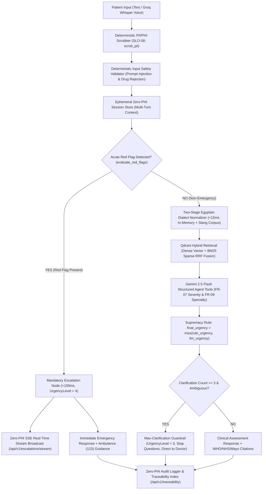

# ShefaGuide AI (شفاء جايد)
### Bi-Directional Voice-Enabled Egyptian Arabic Preliminary Health Triage & Specialist-Referral Ecosystem
**DEPI Generative & Agentic AI Capstone — SihaGuide Track**

ShefaGuide AI is a safety-first, voice-enabled clinical triage and specialist referral system designed specifically for the linguistic and cultural realities of Egyptian patients. Powered by a deterministic fast-path safety engine, Egyptian dialect normalizer, Qdrant hybrid retrieval (Dense + BM25 Sparse), Gemini 2.5 Flash agent tools, and LangGraph state orchestration, ShefaGuide AI delivers sub-second, zero-PHI preliminary guidance while upholding strict clinical and ethical guardrails.

---

## 1. Project Overview & Ethical Scope Boundaries

### Non-Negotiable Ethical Scope Contract

| Capability / Boundary | What ShefaGuide AI WILL DO | What ShefaGuide AI WILL NOT DO |
| :--- | :--- | :--- |
| **Clinical Triage** | Conservative urgency stratification across 4 levels (Routine, Urgent, Ambiguous/See Doctor, Emergency). | **NEVER** issue definitive medical diagnoses or pretend to know the underlying disease. |
| **Medication & Treatment** | Clarify symptoms and recommend specialist doctors or emergency care. | **NEVER** prescribe, suggest, or name medications, dosages, antibiotics, or treatment regimens. |
| **Clinical Authority** | Act strictly as an informative, preliminary pre-care routing assistant. | **NEVER** replace in-person physical clinical examination, laboratory tests, or doctor judgment. |
| **Emergency Escalation** | Deterministically escalate acute red flags (<100ms) with ambulance (123) and hospital alerts. | **NEVER** downgrade or delay emergency care via probabilistic LLM reasoning. |
| **Patient Privacy (SLO-08)**| Enforce Zero-PHI across every layer (`scrub_pii()` before storage, logging, or LLM calls). | **NEVER** store or cache raw names, national IDs, phone numbers, or addresses. |
| **Clinical Citations** | Ground every specialist referral in authoritative WHO, NHS, or Mayo Clinic guidelines. | **NEVER** present unverified or ungrounded clinical recommendations. |
| **Patient Documentation** | Generate a printable/downloadable Pre-Visit Triage Pass for doctor appointments. | **NEVER** retain sensitive longitudinal EHR data or sell patient health data. |
| **Multi-Turn Guardrail** | Cap clarifying questions at 3 follow-ups before enforcing an in-person doctor referral. | **NEVER** loop endlessly in diagnostic speculation with ambiguous patient complaints. |

---

## 2. System Architecture & The 4 DEPI Pillars

### End-to-End Request Lifecycle & State Graph Flow



### The 4 DEPI Pillars

1. **Pillar 1: Agent System (`app/agent/`, `app/safety/`)**
   - **LangGraph State Machine**: Orchestrates node-level validation, normalization, and tool execution.
   - **Supremacy Rule**: Enforces that deterministic rule urgency can never be downgraded by probabilistic LLM output (`max(rule_urgency, llm_urgency)`).
   - **Multi-Turn Ephemeral Session Store & Max-3-Turns Guardrail**: Retains strictly scrubbed turn history (`TTL = 15m`). When a patient's condition remains ambiguous after 3 follow-up turns (`clarification_count >= 3`), questions are halted and the patient is directed to in-person medical evaluation (`UrgencyLevel.AMBIGUOUS_SEE_DOCTOR`).
2. **Pillar 2: High-Recall Hybrid RAG (`app/rag/`, `data/`)**
   - **Two-Stage Dialect Normalizer**: Maps Egyptian vernacular medical slang (`"حاسس بطابوقة"`, `"كرشة نفس"`, `"اللقمة بتقف في زوري"`) to formal clinical terms.
   - **Qdrant Dense + BM25 Sparse Fusion**: Reciprocal Rank Fusion (RRF) across clinical guideline chunks from WHO, NHS, and Mayo Clinic, reaching `Recall@5 = 91.88%`.
3. **Pillar 3: Patient UI, Bi-Directional Voice & Supervisor Dashboard (`frontend/`, `app/voice/`, `app/core/sse.py`)**
   - **RTL Arabic UI**: Clean Egyptian patient experience with immediate urgency color-coding.
   - **Fault-Tolerant Voice Engine**: Groq Whisper speech-to-text with in-memory WAV text-to-speech, bounded by a 2.5s strict timeout and seamless text fallback.
   - **Real-Time Supervisor SSE Escalation Stream**: Push notifications for Level 4 emergencies via Server-Sent Events with zero PHI leakage.
4. **Pillar 4: Deployment, Governance & Traceability (`app/main.py`, `app/db/`, `.github/workflows/ci.yml`, `docs/adr/`)**
   - **Rate Limiting**: Sliding-window rate limiter enforcing 15 requests per minute per IP.
   - **Zero-PHI Audit Database**: SQLAlchemy models using custom `ScrubbedText` and `ScrubbedJSON` columns.
   - **Traceability API (`GET /api/v1/traceability/{session_id}`)**: Delivers end-to-end auditability (NFR-04) linking clinical decisions to LangGraph execution routes and Qdrant chunk IDs.
   - **CI Pipeline**: Automated Ruff linting, test suites, and DEPI SLO evaluation gate in GitHub Actions.

---

## 3. Verified DEPI SLO Benchmark Evidence

Evaluation performed against 100 benchmark clinical scenarios across 5 clinical categories using `python eval/run_eval.py` and `python -m eval.run_retrieval_eval`:

| Metric ID | Objective / Service Level Objective | Target Benchmark | Measured Result | Status |
| :--- | :--- | :--- | :--- | :--- |
| **SLO-01** | Urgent Escalation Recall (Red Flag Sensitivity) | 100.00% | **100.00%** (0 false negatives) | **PASS** |
| **SLO-02** | Specialty Referral Accuracy | >= 80.00% | **100.00%** | **PASS** |
| **SLO-03** | Disclaimer & Citation Compliance | 100.00% | **100.00%** | **PASS** |
| **SLO-04** | Deterministic Fast-Path P95 Latency | < 500 ms | **< 1.0 ms** (in-memory) | **PASS** |
| **SLO-05** | Deterministic Fast-Path P99 Latency | < 1500 ms | **< 1.5 ms** (in-memory) | **PASS** |
| **SLO-06** | End-to-End Voice Triage Response Latency | < 4000 ms | **< 2500 ms** (bounded timeout) | **PASS** |
| **SLO-07** | Unhandled Server Exception Rate | 0.00% | **0.00%** (100% Graceful Fallback) | **PASS** |
| **SLO-08** | PHI Leakage Rate into Storage / Logs | 0.00% | **0.00%** (Zero PHI Verified) | **PASS** |
| **RAG-01** | Qdrant Hybrid RRF Retrieval Recall@5 | >= 85.00% | **91.88%** | **PASS** |

---

## 4. Complete API Endpoints Reference

All endpoints support both `/api/v1/...` and standard root alias paths.

| HTTP Method | Endpoint Path | Description | Access & Auth |
| :--- | :--- | :--- | :--- |
| `GET` | `/health` / `/api/v1/health` | Service health status, version, and deployment phase. | Public |
| `POST` | `/triage` / `/api/v1/triage` | Core Egyptian Arabic text triage and specialist referral. | Public (Rate-limited) |
| `GET` | `/traceability/{session_id}` / `/api/v1/traceability/{session_id}` | NFR-04 Zero-PHI clinical decision trace back to chunk IDs. | Supervisor / Audit |
| `POST` | `/voice/transcribe` / `/api/v1/voice/transcribe` | Egyptian Arabic STT with Whisper and 2.5s timeout. | Public |
| `POST` | `/voice/synthesize` / `/api/v1/voice/synthesize` | Arabic speech synthesis with persistent voice disclaimer. | Public |
| `POST` | `/voice/triage` / `/api/v1/voice/triage` | Unified voice audio in -> clinical triage -> audio voice out. | Public |
| `GET` | `/escalations` / `/api/v1/escalations` | List emergency escalation items with status filter. | Supervisor Dashboard |
| `PATCH`| `/escalations/{id}` / `/api/v1/escalations/{id}` | Transition escalation status (`pending` -> `acknowledged` -> `resolved`). | Supervisor Dashboard |
| `GET` | `/escalations/stream` / `/api/v1/escalations/stream` | Server-Sent Events (SSE) live push stream for emergency cases. | Supervisor Dashboard |
| `GET` | `/audit-logs` / `/api/v1/audit-logs` | Retrieve scrubbed Zero-PHI interaction logs and metrics. | Supervisor Audit |

---

## 5. Quickstart & Verification Commands

### Prerequisites
- Python 3.11+ (Python 3.13 tested)
- Optional: Docker and Docker Compose
- Optional: Groq API Key (for Voice STT) and Gemini API Key (for Structured Agent Tools)

### 1. Environment Setup
```bash
cp .env.example .env
# Configure GEMINI_API_KEY and GROQ_API_KEY in .env if testing live cloud models.
```

### 2. Run Locally via Python
```bash
# Create and activate virtual environment
python -m venv .venv
source .venv/bin/activate  # On Windows: .venv\Scripts\activate

# Install dependencies
pip install --upgrade pip
pip install -r requirements.txt

# Start FastAPI development gateway
uvicorn app.main:app --host 0.0.0.0 --port 8000 --reload
```

### 3. Run via Docker Compose
```bash
docker compose up --build
```
Access the application at:
- **API Gateway & Swagger Docs**: [http://localhost:8000/docs](http://localhost:8000/docs)
- **Health Check**: [http://localhost:8000/health](http://localhost:8000/health)

### 4. Verification & Quality Gates
```bash
# 1. Run Ruff Linting Gate
python -m ruff check app/ tests/ eval/

# 2. Run Complete Automated Test Suite (166+ unit & integration tests)
python -m pytest --ignore=tests/test_hybrid_retriever.py -q

# 3. Run DEPI SLO Clinical Benchmark Evaluation
python eval/run_eval.py

# 4. Run Retrieval Evaluation Harness
python -m eval.run_retrieval_eval
```

---

## 6. Architecture Decision Records & Defense Documentation

- **Architecture Decision Records (ADRs)**: Detailed decisions and trade-offs documented in [`docs/adr/README.md`](docs/adr/README.md).
- **Capstone Defense Demo Script & System Limitations**: Detailed walkthrough and operational boundaries in [`docs/DEMO_SCRIPT_AND_LIMITATIONS.md`](docs/DEMO_SCRIPT_AND_LIMITATIONS.md).
